# emulens

GPU-accelerated lens, optical, camera, and film-emulation effects for OBS Studio.
Use emulens as a source filter to build everything from restrained optical
imperfections to deliberately stylized analog looks without leaving the OBS
graphics pipeline.

**Public preview — v0.5.0.** All 17 effects, including Wet Lens and Phone Wet Lens, are in this snapshot. Linux has passed isolated OBS/OpenGL tests. Windows and macOS compile/package success does not yet establish that the plugin loads and renders correctly on those platforms. See [CHANGELOG.md](CHANGELOG.md) and [release testing boundaries](docs/RELEASE_CHECKLIST.md).

## Showcase

Actual OBS renders using shipped defaults and selected presets.

<table>
  <tr>
    <th>Original</th>
    <th>Vidicon</th>
    <th>Starburst</th>
  </tr>
  <tr>
    <td align="center"></td>
    <td align="center">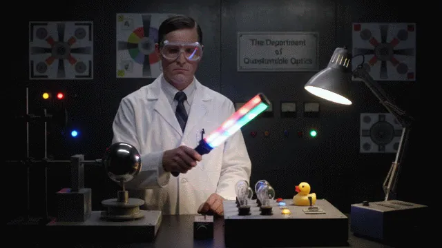</td>
    <td align="center">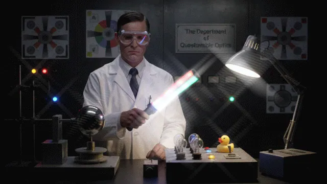</td>
  </tr>
  <tr>
    <th>Light Leak</th>
    <th>Handheld</th>
    <th>Bokeh</th>
  </tr>
  <tr>
    <td align="center">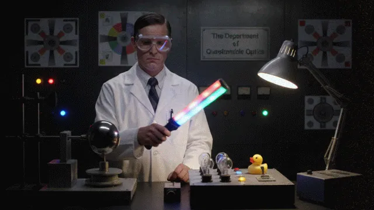</td>
    <td align="center">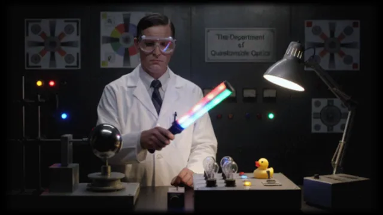</td>
    <td align="center"></td>
  </tr>
  <tr>
    <th>Particles</th>
    <th>Orton Glow</th>
    <th>Film Grit</th>
  </tr>
  <tr>
    <td align="center">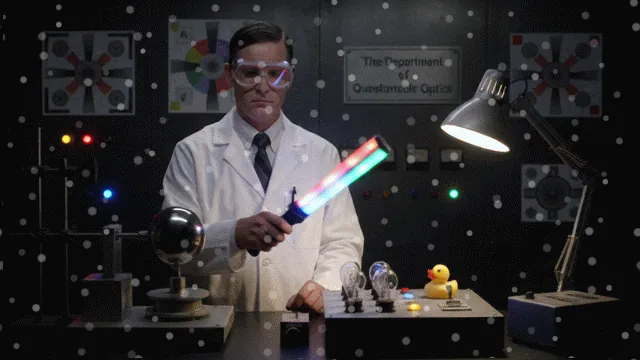</td>
    <td align="center">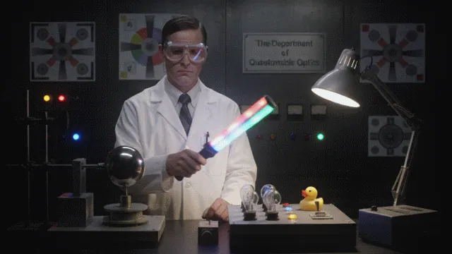</td>
    <td align="center">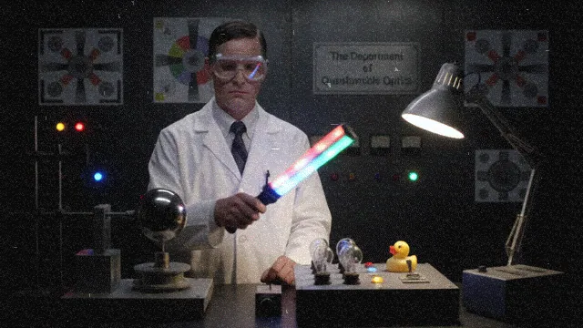</td>
  </tr>
  <tr>
    <th>Mirage</th>
    <th>Center Spot</th>
    <th>Bloom</th>
  </tr>
  <tr>
    <td align="center"></td>
    <td align="center"></td>
    <td align="center">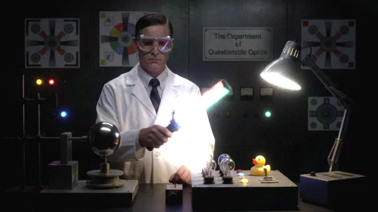</td>
  </tr>
  <tr>
    <th>Pinhole</th>
    <th>Polaroid</th>
    <th>Daguerreotype</th>
  </tr>
  <tr>
    <td align="center">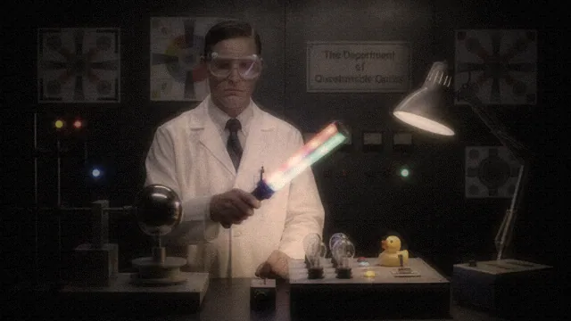</td>
    <td align="center">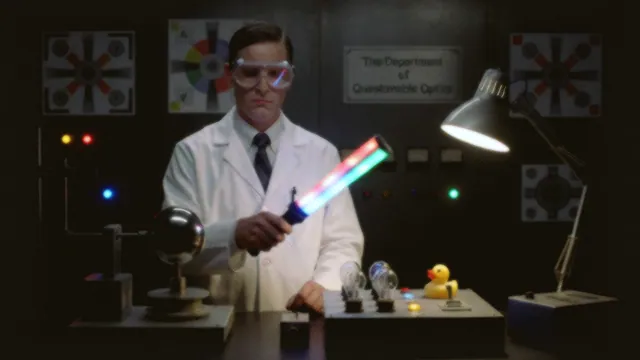</td>
    <td align="center"></td>
  </tr>
  <tr>
    <th>Technicolor 2-Strip</th>
    <th>Wet Lens</th>
    <th>Phone Wet Lens</th>
  </tr>
  <tr>
    <td align="center">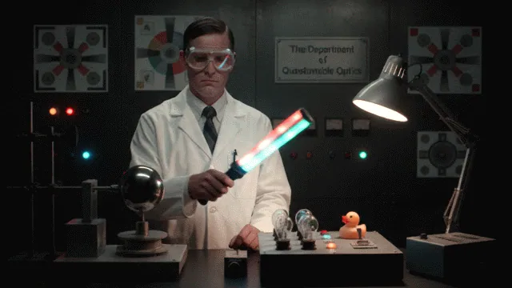</td>
    <td align="center"></td>
    <td align="center"></td>
  </tr>
</table>

## Features

- 19 real-time optical, camera and film effects with 72 presets.
- GPU-native rendering, including multipass bloom and time-dependent Vidicon trails.
- Clear starting points with per-effect controls; no external optical-overlay assets.
- Works with upstream OBS filters, including scaling and cropping.

## Verified GitHub Actions builds

The current module name is `emulens`. The November 20 rename snapshot
[`ebc2150`](https://github.com/myrqyry/emuLens/actions/runs/44685880736)
passed Windows and macOS packaging, static tests and formatting, but its
Linux build failed before module compilation because the SDK bootstrap
flag was incorrectly capitalized. The separate
[OBS 33.0.1 build](https://github.com/myrqyry/emuLens/actions/runs/44685880558)
passed for that snapshot. The corrected Linux path has been qualified
locally with the pinned OBS 32.1.0 SDK: 51 native tests passed, including
the Wet Lens and Phone Wet GPU render checks; one optional obspython
integration case was skipped. The staged Linux module and effect resources,
installer regression, and source-archive exclusion canaries also passed
locally. The reconciled snapshot `887b290` subsequently passed [all five baseline jobs](https://github.com/myrqyry/emulens/actions/runs/45908543420) and the [OBS 33.0.1 compatibility build](https://github.com/myrqyry/emulens/actions/runs/45908543329).


The public [CI workflow](https://github.com/myrqyry/emuLens/actions/workflows/ci.yml)
builds Linux x86_64, Windows x64 and macOS packages and runs formatting,
Python checks, installer-safety tests and Linux native/GPU render tests.
The [shared OBS plugin CI workflow](https://github.com/myrqyry/emulens/actions/workflows/obs33-compatibility.yml)
targets OBS 32.2.0 and 33.0.3 on Linux x86-64, Windows x64 and native Intel/Apple Silicon macOS.
It produces versioned test archives and checksums; Linux retains the real GPU/native test floor.
The original OBS 32.1.0 baseline remains intact during qualification. See [shared CI](docs/SHARED_CI.md).

For the public snapshot `354c87a` (November 9, 2026), both
workflows passed:

- [Main CI: all five jobs passed](https://github.com/myrqyry/emuLens/actions/runs/42732888596).
  Downloadable artifacts: `emulensfx-linux-obs32`,
  `emulensfx-windows-obs32` and `emulensfx-macos-obs32`.
- [OBS 33.0.1 compatibility: passed](https://github.com/myrqyry/emuLens/actions/runs/42732888818).

The packages contain the platform-specific module/bundle,
`emulens.effect` and all 61 presets; the Linux package also includes
localization. The downloaded source archive passed the private-file
exclusion checks. GitHub retains workflow artifacts for a limited time.
There is no tagged or signed GitHub Release yet.

**Compatibility:** OBS 32.1.0+ is required, but a module compiled
against a newer libobs SDK may not load in an older OBS installation.
Windows and macOS packaging success does not establish runtime loading
or visual correctness on those platforms.

## Installation

OBS should be closed while replacing the plugin binary. Restart OBS after an
install so the shared module and shader data are reloaded together.

### Cross-platform wrapper

On Linux and macOS:

```bash
./build.sh
```

`build.sh` dispatches to the native installer. In a Windows-like shell it
prints the PowerShell command to use instead of attempting a Unix install.

### Linux

```bash
./install_local.sh
```

Installs to:

```text
~/.config/obs-studio/plugins/emulens
```

The installer supports explicit libobs CMake discovery overrides:

```bash
OBS_CMAKE_DIR=/path/to/libobs/cmake ./install_local.sh
# or
libobs_DIR=/path/to/libobs/cmake ./install_local.sh
```

It stages the CMake install into a temporary prefix, then copies the real module
and data tree into the OBS user-plugin layout.

Verify a Linux user install with:

```bash
./verify_install.sh
```

The verification script checks the plugin directory, shared module, shader,
preset directory, and locale directory. For release candidates, verify the staged binary and accompanying resources **without installing over a running user's plugin**. CPack source packaging does not honor Git ignore; the [release checklist](docs/RELEASE_CHECKLIST.md) includes mandatory source-archive privacy checks.

### macOS

```bash
./install_local_macos.sh
```

Installs to:

```text
~/Library/Application Support/obs-studio/plugins/emulens
```

Choose a CMake configuration through `BUILD_TYPE`:

```bash
BUILD_TYPE=RelWithDebInfo ./install_local_macos.sh
```

When Homebrew OBS is present, the installer supplies its prefix to CMake
automatically. The installer defaults to `Release`; `BUILD_TYPE=RelWithDebInfo` is optional.

### Windows

Run from PowerShell:

```powershell
.\install_local.ps1
```

The installer defaults to `Release`. Supported values are `Debug`,
`Release`, `RelWithDebInfo`, and `MinSizeRel`:

```powershell
.\install_local.ps1 -BuildType RelWithDebInfo
```

The user plugin is installed under
`%APPDATA%\obs-studio\plugins\emulens`.

The installers choose the user-level paths shown above; a custom prefix
is not needed for a default install. On Linux, `install_local.sh`
builds into a disposable stage, validates the binary/effect/locale and
prepares a rollback-safe replacement. Windows and macOS installation
still needs runtime verification on those platforms. Restart OBS afterward.

## Usage

1. Add a video or image source to a scene.
2. Right-click the source → **Filters**.
3. Click **+** → **emulens**.
4. Choose an **Effect Type**.
5. Start from a preset or tune the visible controls directly.

### Effects

| Effect | Current behavior | Presets (OBS menu names) |
|---|---|---|
| **Vidicon (Trails)** | Pickup-tube image persistence with temporal RGB lag, red-dominant retention, optional comet/smear artifacts, tube noise, scanlines, registration drift, halation, and hum | **Vidicon: Tube Camera**, Vidicon: Long Exposure, Vidicon: Clean Tube |
| **Starburst** | Diffraction stars from point/specular highlights; brighter highlights produce stronger and longer rays | **Starburst: Diffraction**, Starburst: Horizontal Streak, Starburst: Glint, Starburst: Cross Filter |
| **Film Burn / Leak** | Procedural edge-biased light leaks with color shifting, directional bias, streaking, complexity, and multiple blend modes | **Film Burn: Edge Leak**, Film Burn: Warm Edge, Film Burn: Gate Flash, Film Burn: Amber |
| **Handheld Camera** | Position/rotation drift, breathing, tremor, step bob, inertia, correction motion, and optional blur | **Handheld: Operator**, Handheld: Running, Handheld: Breathing, Handheld: Drift |
| **Bokeh / Tilt-Shift** | Shallow depth-of-field with configurable focus region, highlight response, and 3–8 sided aperture shapes | **Bokeh: Natural**, Bokeh: Center Focus, Bokeh: Soft Focus, Bokeh: Night Lights |
| **Particles** | Floating dust, snow, and motes with source influence, focus shaping, polygonal particles, chromatic separation, and size-aware energy | **Particles: Natural**, Particles: Dust, Particles: Prism Motes, Particles: Snow |
| **Orton Glow** | Soft-focus photographic glow with blur, contrast, brightness, saturation, highlight boost, and blend modes | **Orton: Soft Print**, Orton: Veil, Orton: Dream Print, Orton: Velvet |
| **Film Grit** | Film-stock dirt, scratches, grain, flashes, instability, tone controls, scratch types, blend modes and optional highlight-driven halation | **Grit: Fine Stock**, Grit: 1920s, Grit: Worn Print, Grit: Projector, Grit: Halation Stock |
| **Mirage** | Layered mirrored/kaleidoscopic image echoes; large radius values reflect at image bounds instead of dropping samples to black | **Mirage: Glass Echo**, Mirage: Kaleidoscope, Mirage: Double Vision, Mirage: Split |
| **Center Spot** | Clear center with an optical outer ring: Soft Diffusion, Diopter, or Radial Zoom | **Spot: Soft Spot**, Spot: Diopter, Spot: Diffusion, Spot: Radial Zoom |
| **Bloom / Glow** | Multi-level bright-pass bloom with optional fixed lens contamination that scatters, veils, glints, refracts, ghosts, and supports anamorphic response | **Bloom: Clean Highlights**, Bloom: Halation, Bloom: Dusty Lens, Bloom: Night Glass, Bloom: Coated Glass |
| **Pinhole** | Soft lensless-camera rendering with vignette, distortion, sepia, and grain | **Pinhole: Optical**, Pinhole: Classic, Pinhole: Album Print |
| **Polaroid** | Instant-film color response with softness, vignette, emulsion shift, development, grain, and bleed | **Polaroid: Fresh Pack**, Polaroid: Warm Pack, Polaroid: Expired Pack |
| **Daguerreotype** | Silver-plate contrast, grain, tint, vignette, and edge softness | **Daguerreotype: Balanced Plate**, Daguerreotype: Polished Plate, Daguerreotype: Tarnished Plate |
| **Technicolor 2-Strip** | Restricted red/cyan dye-transfer character with saturation, strip offset, and glow | **Technicolor: Balanced Two-Strip**, Technicolor: Two-Strip Print, Technicolor: Registration Slip |
| **Wet Lens** | Stationary water-bead refraction of captured live pixels, with light-gathering glints | **Clean Raindrops**, Night Window |
| **Phone Wet Lens** | Broad near-lens refraction regions, captured-light ribbons and veiling glare | **Wet Phone Camera**, Rain on Streetlights, Heavy Wet Optics |
| **Cinema Diffusion** | Separate detail softening and thresholded highlight scatter; five optical-inspired profiles including a fixed weave | **Diffusion: Pro-Mist**, Diffusion: Black Pro-Mist, Diffusion: Satin, Diffusion: Digital Diffusion, Diffusion: Black Net |
| **Diopter** | Movable, rotatable full/split/strip/letterbox glass mask with local defocus, magnification and chromatic fringe | **Diopter: Split Field**, Diopter: Full Field, Diopter: Strip, Diopter: Letterbox, Diopter: Rotated Split |

**Bold** preset names are the defaults. All names above match the OBS preset menu.

## Effect controls

See the [optical behavior and controls guide](docs/EFFECTS.md) for detailed
information on Vidicon persistence, Bloom, Center Spot, Starburst, Mirage,
Particles and water-on-lens effects.

To reproduce the animations, see [Capture an effect showcase](docs/SHOWCASE.md).

## Building

### Prerequisites

- OBS Studio development headers (`32.1.0+`)
- CMake `3.28+`
- C17-compatible compiler
- Python 3 for contract tests
- Ninja for the shipped Ubuntu CMake preset
- Visual Studio 2022 for the shipped Windows x64 preset
- Xcode for the shipped macOS preset

### Direct CMake build

```bash
cmake -S . -B build
cmake --build build
```

For local installation, prefer the platform installer so the module/data layout
matches what OBS expects.

### CMake presets

The repository ships configure/build presets for the supported CI/development
targets:

```bash
# Linux
cmake --preset ubuntu-x86_64
cmake --build --preset ubuntu-x86_64

# macOS
cmake --preset macos
cmake --build --preset macos

# Windows
cmake --preset windows-x64
cmake --build --preset windows-x64
```

CI variants are available as `ubuntu-ci-x86_64`, `macos-ci`, and
`windows-ci-x64`.

## Tests

The canonical local test entry point is:

```bash
./tests/run_tests.sh
```

It configures the standalone test project, builds it, runs CTest, and then runs
the optional OBS Python integration test when `obspython` is available.

Choose a different test build directory with:

```bash
EMULENS_TEST_BUILD_DIR=/tmp/emulens-tests ./tests/run_tests.sh
```

Equivalent manual commands are:

```bash
cmake -S . -B tests/build -DENABLE_TESTING=ON
cmake --build tests/build --parallel "$(nproc)"
ctest --test-dir tests/build/tests --output-on-failure
```

Focused Python contract tests can run without the OBS Python runtime, for
example:

```bash
python3 tests/test_shader_syntax.py
python3 tests/test_render_pipeline.py
python3 tests/test_gpu_resources.py
python3 tests/test_bloom_lens_effect.py
python3 tests/test_intended_effects_recovery.py
python3 tests/test_mirage_radius_bounds.py
python3 tests/test_vidicon_reference_model.py
```

The November 26 optical reconciliation passed 53 of 54 registered CTest entries on Linux, including real OBS/OpenGL Wet Lens, Phone Wet Lens and optical flare pixel tests. `PythonIntegrationTest` skipped because `obspython` was unavailable. Six isolated installer-safety tests also passed. This is not full GUI, streaming-performance, or cross-platform runtime qualification.

## Architecture

emulens uses a strategy-per-effect architecture.

- **Core rendering** (`src/lens-core.c`) — filter lifecycle, settings snapshots,
  shared GPU resources, render dispatch, dimensions, and final composite.
- **OBS helpers** (`src/obs-utils.c`) — upstream capture, common parameter
  binding, shader loading, render helpers, and settings rebinding.
- **Effect strategies** (`src/strategies/`) — one file per effect mode.
- **UI** (`src/lens-ui.c`) — dynamic OBS properties, mode visibility, preset
  selection, and control ranges.
- **Shaders** (`data/emulens.effect`) — effect uniforms and the 22 cached
  techniques used by the strategies.
- **Presets** (`data/presets/`) — 72 JSON files: 19 defaults + 53 alternates.
- **Localization** (`data/locale/`) — property labels, tooltips, mode names,
  preset names, and descriptions.
- **Tests** (`tests/`) — shader/static contracts, reference models, resource
  lifecycle checks, C++ strategy tests, and optional OBS Python integration.

## OBS/runtime contract

The plugin follows the OBS source/filter lifecycle rather than treating module
loading or compilation as proof that an effect works.

- GPU resources are created and destroyed only with a valid OBS graphics
  context.
- The current filter target is used inside the render lifecycle; recursive
  source-size callbacks are not used for filter dimensions.
- Common parameter binding can disturb mode-specific effect state on some
  backends, so strategies that need it rebind current settings immediately
  afterward. Bloom does this across its multipass pipeline.
- Settings snapshots and render work use bounded synchronization; render
  callbacks avoid filesystem/network I/O and blocking waits.
- Persistent texrenders are reused rather than allocated per frame.
- Expected per-frame rendering is silent. Logging in hot render paths is
  reserved for actionable failures rather than entry/exit traces.
- Runtime validation instantiates the real filter and shader in OBS and checks
  rendered output, not just module loading.

The current runtime harness exercises OBS Studio 32.2.0 on Linux/OpenGL,
including Vidicon temporal persistence, the Trail Decay curve, oversized
particles, Mirage at large radius, Center Spot optical families,
highlight-driven Starburst, large-radius bloom, Dusty Lens light response, and
fixed-in-lens-space contamination.

## License

emulens is licensed under the GNU General Public License version 2 or later
(`GPL-2.0-or-later`), matching OBS Studio's licensing. See [LICENSE](LICENSE).

## Credits

Developed for the OBS Studio community.

Film Grit includes an opt-in, highlight-driven film-halation control and Halation Stock preset. Existing Grit presets retain their appearance (halation off).
